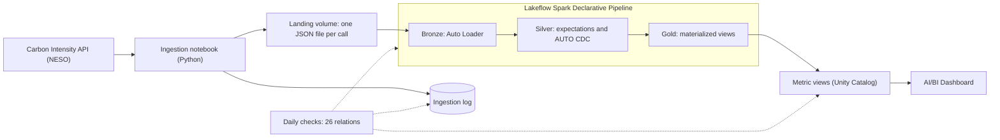

# 🇬🇧 UK Carbon Intensity Lakehouse

> **In which hour is the electricity of my region cleanest?** For example, when should I start the washing machine?

This project answers that question for the 14 regions of Great Britain. It ingests carbon intensity and generation mix data every day from the public Carbon Intensity API (NESO), processes it through a **medallion architecture** (bronze, silver, gold) on **Databricks Free Edition**, and exposes every formula once, in **Unity Catalog metric views**, for the dashboard and any other tool.

**Status:** 🚧 in progress, target December 2026. Ingestion, bronze, silver, gold, metric views and automated checks are complete; the dashboard is next.

> 📊 *Dashboard screenshot: coming with the dashboard.*

The detailed design (measured API behaviour, decisions layer by layer, data quality rules, orchestration) is in **[docs/design.md](docs/design.md)**.

---

## 🏗️ Architecture and Data Flow



### 1. Ingestion
* A Python notebook calls the regional endpoint for all regions at once and lands the response **unchanged** as one JSON file per call in a Unity Catalog volume.
* Every call is written to an **ingestion log**, with the half hours received, the half hours expected and a **completeness flag**.
* A **guard** counts the windows still to download and stops an oversized backfill before the first call.

### 2. Bronze
* **Auto Loader** reads only the new files; one row per file, all fields as strings, so the bronze layer never fails on a data type.
* Duplicates are kept on purpose: bronze is a faithful copy of what the API returned.

### 3. Silver
* The JSON is parsed with an explicit schema (the contract with the API) and split into **one table per grain**: intensity (region and half hour), generation mix (region, half hour and fuel), regions.
* **12 expectations**: rules that only warn count the row, rules on the keys stop the update.
* **AUTO CDC** (a declarative `MERGE`, SCD type 1) removes the overlaps between files: the most recently written file wins.

### 4. Gold
* Two **materialized views** at the finest grain, one for intensity and one for the generation mix, with region names, London clock time and calendar columns. They store no averages.
* Timestamps are **stored in UTC and shown in London time**, so days are cut at London midnight.

### 5. Metric views
* Two metric views hold the measures: `metrics_carbon_intensity` and `metrics_generation_mix`. Whoever queries them chooses the grouping.
* Created once by a setup notebook, **not by the pipeline**: a metric view stores no data, and a pipeline rejects the `WITH METRICS` clause (tested).

### 6. Orchestration and checks
* A **Lakeflow Job** runs every day at 18:10 (Europe/Rome): `ingest_update` (the last 48 hours), then `refresh_pipeline`, then `daily_checks`.
* A checks notebook runs **26 checks** after every refresh, one row per check, `OK` or `KO`, plus a summary row. It is the third task of the job: a `KO` fails the run and sends the failure email.

---

## 🚀 Key Engineering Highlights

* **The log knows what it should have received.** Each call stores the expected half hours next to the received ones: an HTTP 200 with missing data is flagged, not trusted.
* **Overlaps by design, duplicates never.** The daily job asks for 48 hours every 24, so a failed day is recovered by the next run; AUTO CDC removes the overlap in one place.
* **Master and detail stay separate.** Intensity has one row per region and half hour, the mix has nine. Joining them would repeat each value nine times, so there are two views and two metric views, each formula at its own level.
* **No average of averages.** Every average is a sum divided by a count at query time; the share of a fuel group is the sum of the percentages divided by the number of region and half hour pairs.
* **A metric view that answers is not necessarily right.** Every dimension and measure was reconciled against a hand-written query with independent formulas (seven tests, `FULL OUTER JOIN` so that a missing group shows up).
* **Checks test relations, not numbers.** For example: gold rows equal silver rows, the mix has nine rows per intensity row, the last half hour matches the log. The checks were also run against deliberately broken data, to prove that they can fail.
* **Clock changes as a test.** In London time the last Sunday of March has 46 half hours and the last Sunday of October 50: seeing them in the gold layer proves that days are cut in London time.

---

## 🛠️ Tech Stack

* **Platform:** Databricks Free Edition (serverless), Unity Catalog
* **Languages:** Python (ingestion, bronze, silver), SQL (gold, metric views, checks)
* **Frameworks:** Lakeflow Spark Declarative Pipelines, Auto Loader, AUTO CDC, Delta Lake
* **Orchestration:** Lakeflow Jobs
* **Semantic layer:** Unity Catalog metric views (YAML, version 1.1)
* **Visualization:** AI/BI Dashboard (in progress)
* **Version control:** Git folder in Databricks, GitHub, one pull request per layer

---

## 📊 Data

| Item | Value |
|---|---|
| Regions | 14 distribution network areas of Great Britain (the API aggregates England, Scotland, Wales and GB are not used) |
| Granularity | 30 minutes, UTC |
| History | From November 2024, refreshed every day |
| Volume | Over 500,000 rows of carbon intensity and over 4.5 million rows of generation mix |
| Known gaps in the source | 25 half hours per region (January and August 2025), documented and not recoverable |

---

## 📁 Repository Layout

```
uk-carbon-intensity-lakehouse/
├── setup/                     # catalog, schemas, volume, metric views (run once, idempotent)
├── ingestion/                 # notebook that calls the API and writes files and log
├── pipeline/transformations/  # 01_bronze.py, 02_silver.py, 03_gold.sql
├── checks/                    # daily checks after the refresh job
├── docs/design.md             # detailed design
└── exploration/               # first inspection of the API (not part of the pipeline)
```

---

## ▶️ How to Reproduce

On a Databricks Free Edition workspace, with this repository cloned as a Git folder. The API needs no key.

1. Run `setup/00_create_catalog_schema_volume` and `setup/02_create_layer_schemas`. (`setup/01` is only for ingestion logs created before 2026-11-11.)
2. Run `ingestion/01_ingest_regional_api` with `mode` = `backfill`, a start and an end date, `block_days` = `7`, and `max_windows` raised to the number of windows you want (the guard stops at 30 by default). Re-download the days around each year end with `block_days` = `1` ([design.md, 1.5](docs/design.md#15-design-consequences)).
3. Create the pipeline `uk_carbon_pipeline` with the settings in [design.md, section 6](docs/design.md#6-pipeline-uk_carbon_pipeline) and run it.
4. Run `setup/03_create_metric_views`.
5. Create the job `uk_carbon_refresh` with the settings in [design.md, section 7](docs/design.md#7-orchestration-job-uk_carbon_refresh).
6. The job also runs `checks/01_daily_job_checks` as its last task: the summary row must be `0`, otherwise the run fails.

*These steps have not yet been rehearsed on an empty workspace: that test is planned before the project is closed.*

---

## ⚠️ Known Limits

* **Averages across regions are not weighted by consumption:** the regional API does not provide demand.
* **The carbon intensity is a NESO estimate** (`forecast`), not a measured value. Regional data are flagged as beta by NESO.
* **Free Edition:** serverless only, daily quotas, no commercial use. The job runs the branch checked out in the Git folder.
* **Pipeline and job settings live in the workspace**, documented in `design.md`; Databricks Asset Bundles are a possible next step.

---

## 📄 Data Source and Attribution

*Data: Carbon Intensity API, National Energy System Operator (NESO), CC BY 4.0.* API usage is also subject to the [Terms of Use](https://github.com/carbon-intensity/terms). This project is not endorsed by NESO.

Code released under the **GNU General Public License v3.0** (see the `LICENSE` file at the root of the repository).